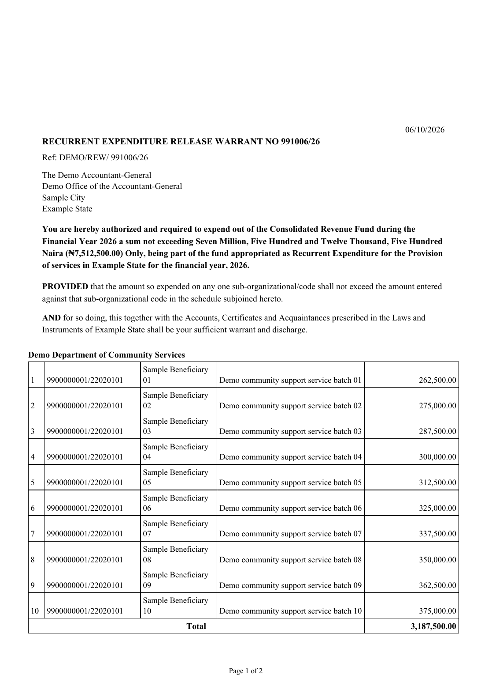
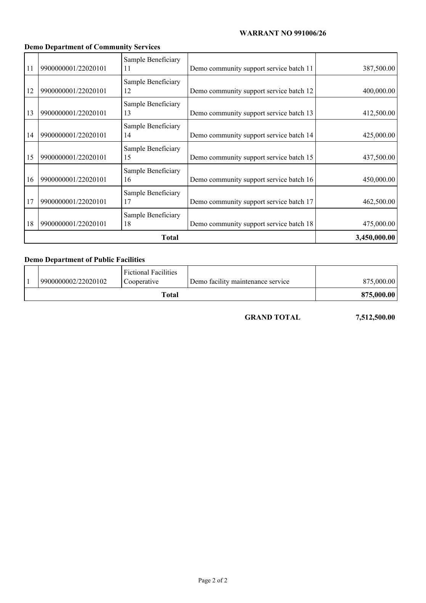

# Warrant Management System - Portfolio Demo

A Python desktop application for preparing and managing expenditure release warrants. This portfolio edition is isolated from the operational WMS data folder and uses fictional catalogue entries, beneficiaries, organizations, dates, and amounts.


## Sample output

These pages were generated by the app's PDF renderer with fictional demo records. They show the authorization page, a schedule continuing onto page 2, continuous line numbers, page subtotals, and the grand total.





The complete sample PDF is in [`samples/fictional-warrant-example.pdf`](samples/fictional-warrant-example.pdf).

## Features

- Create Recurrent and Capital warrants with multiple organizations and schedule lines.
- Validate dates, warrant numbers, payees, amounts, economic codes, and code-type rules.
- Remember and suggest previously used payees.
- Calculate schedule subtotals and grand totals, and paginate schedules with continuous serial numbers.
- Preview, print, and export A4 PDFs with configurable fonts, text styles, columns, margins, and page layout.
- Save and search warrants in SQLite, retain revisions, and guard against duplicate or stale updates.
- Reprint saved warrants after catalogue or settings changes.
- Back up and restore data, share editable warrant files, import/export settings, and schedule weekly PDF exports.
- Use Carbon, Executive, Emerald, Ocean, Classic, or automatic light/dark themes.

## Technology

- Python and Tkinter for the desktop application
- SQLite for application records and the demo catalogue
- ReportLab for PDF generation
- PyMuPDF for PDF preview support
- Pillow for image handling
- pywin32 for direct Windows printing

## Run on Windows

This edition targets 64-bit Windows 10/11. Install Python 3 with `pip` available. From this folder, install the dependencies:

```bat
py -3 -m pip install -r requirements.txt
```

Then start the app:

```text
Run Warrant System V12.bat
```

The launcher can install missing packages; that requires internet access. Tkinter is included with most Windows Python installers.

To build a standalone Windows package, run `Build Portable App.bat`. The build downloads its packaging tools and may take a few minutes.

**Data isolation:** the portfolio edition stores its runtime data under `%PROGRAMDATA%\WarrantSystemPortfolioDemo` (or `%LOCALAPPDATA%\WarrantSystemPortfolioDemo` if needed). It does not use the operational WMS data directory. Keep production data and backups out of this repository.

## Run the tests

```bat
py -3 -m unittest discover -s tests -t . -v
```

Or double-click `Run Tests.bat`. The suite covers date and number handling, input validation, storage and backups, sharing, release packaging, and PDF pagination/totals. The test fixtures use fictional organization codes and names.

The V12.7.3 release suite previously passed 73 tests with `ResourceWarning`s treated as errors. This portfolio copy changes the bundled database and test fixtures to synthetic values; rerun the suite on this copy before relying on that result.

## Project map

- `warrant_app_v12.py` - desktop interface and application startup
- `wms_store.py` - SQLite storage, validation, backup, and warrant operations
- `wms_engine.py` - document layout, pagination, totals, and PDF rendering
- `wms_print.py` - Windows print integration
- `wms_weekly.py` - weekly PDF export
- `wms_dates.py`, `wms_share.py`, `wms_branding.py` - date handling, sharing, and branding support
- `tests/` - automated regression suite with synthetic fixtures
- `warrant_data.db` - fictional demo catalogue required by the application
- `samples/` and `docs/images/` - fictional sample warrant and rendered page images

## Release and licensing

Portfolio edition based on WMS **12.7.3**. See [`CHANGELOG.md`](CHANGELOG.md) for release notes.

No project reuse license is declared here. Do not assume permission to reuse or redistribute the application. The font license notices in `fonts/licenses/` apply to those font files.
